**Nairobi, Kenya · Building web products and applied AI systems**

[🌐 Portfolio](https://gigitogigs.github.io/Ngige) · [💼 LinkedIn](https://linkedin.com/in/ngige-mwaniki-b08287278) · [✉️ Email](mailto:ngigemwaniki2004@gmail.com)

I'm Ngige (Gigito), a full-stack developer working with Next.js, Django REST Framework, and Python. I build across the stack, from interfaces and APIs to databases and local AI tools, with particular attention to authentication, permissions, and auditability.

**Open to full-stack and ML/AI engineering roles, freelance projects, and contract work.**

## 🚀 Selected work

### 🔒 Friday — Offline AI agent

A local Python/Ollama agent exploring how to make autonomous tools accountable. Built a six-level permission system, explicit approval workflows for sensitive operations, and append-only JSONL audit logging, with a 12-test pytest suite.

**Python · Ollama · Click · Rich · pytest** 
[Explore the repository →](https://github.com/Gigitogigs/Friday)

### 📸 Lens.ke — Kenyan stock photography platform

Built the complete Next.js frontend at Lenana Labs: an editorial homepage, infinite-scroll search with tag, category, and location filters, an image lightbox, and a contributor earnings dashboard. Implemented in-memory access tokens, HttpOnly refresh-token rotation, and protected routes.

**Next.js · Django REST Framework · PostgreSQL** 
*Private repository · Lenana Labs*

### ⚖️ W Mwaniki & Associates Advocates — Law firm website

Delivered the site from brief and design through deployment, including nine practice-area pages and their content. Implemented structured data, on-page SEO, a Content Security Policy, code splitting, and asset optimization.

**Next.js · SEO · Performance optimization · Truehost** 
*Private repository · Client project*

<strong>More applied ML projects</strong>

- **F1 Race Winner Predictor:** A Random Forest model using historical race data, with preprocessing, training, and prediction in a scikit-learn pipeline.
- **CNN Fruit Classifier:** Image classification on the Fruits-360 dataset using convolutional neural networks.

## 🔭 Building now

- **Adia:** A jewelry e-commerce platform inspired by Nairobi craftsmanship. Building the storefront, checkout, and order management with Next.js, Tailwind CSS, Django REST Framework, and PostgreSQL.
- **Campus Hub:** A student events hub and peer-to-peer marketplace for Kenyan Universities, with a modular Django REST Framework backend.
- **Exploring:** Agentic workflow automation for small businesses in East Africa.

## 🛠️ Tools I work with

  

| Area | Technologies |
| --- | --- |
| Languages | Python, TypeScript, JavaScript, Java |
| Frontend | Next.js, React, Tailwind CSS, HTML, CSS |
| Backend & data | Django REST Framework, FastAPI, Node.js, PostgreSQL, Supabase |
| AI & ML | PyTorch, TensorFlow, scikit-learn, Ollama |
| Development | Git, GitHub, pytest, Postman |

## 💼 Experience & background

- **Subject Matter Expert · Snorkel AI** — Sep 2025–Present. Evaluate and generate technical content in programming and applied mathematics for AI research workflows, drawing on Python, algorithms, and numerical methods.
- **Frontend Developer · Lenana Labs** — 2025–Present. Frontend engineering for Lens.ke, featured above.
- **Web Developer · W Mwaniki & Associates Advocates** — Apr 2025–Jan 2026. Website design, development, and deployment, featured above.

**Education:** Mathematics & Computer Science, Kenyatta University. 
**Certifications:** AI Foundation — Encode Club; Microsoft Professional Program in AI — FutureLearn.

## 🐍 Around GitHub

<strong>Stats & languages</strong>

  
  

<picture>
  <source media="(prefers-color-scheme: dark)" srcset="assets/github-snake-dark.svg" />
  <source media="(prefers-color-scheme: light)" srcset="assets/github-snake.svg" />
  
</picture>

---

Have a product to build or an engineering role to discuss? [Get in touch →](mailto:ngigemwaniki2004@gmail.com)
